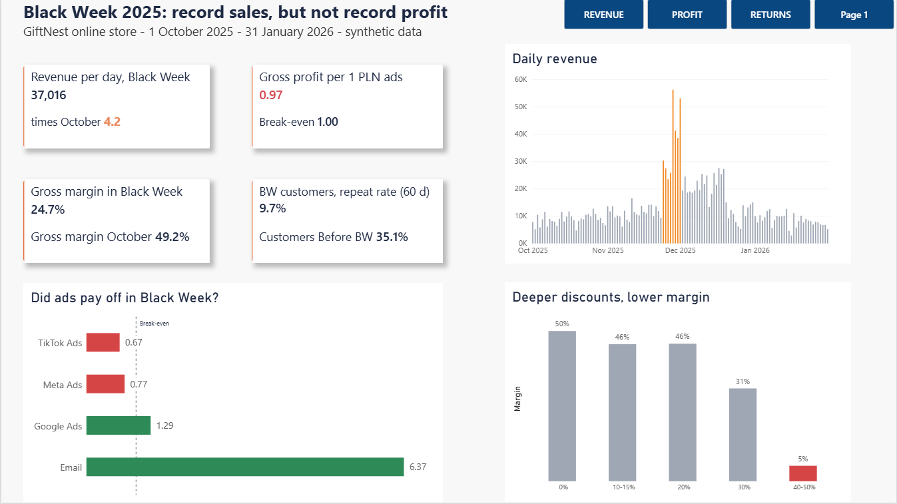

# GiftNest Black Week & Christmas — Sales, Profit and Returns Analysis

## Tech Stack
- **Excel (Microsoft 365):** data cleaning, XLOOKUP, COUNTIFS, MINIFS, IFS, pivot tables
- **Power BI:** Power Query, star schema data model, DAX measures, drill-through, conditional formatting
- **DAX:** CALCULATE, DIVIDE, REMOVEFILTERS, SELECTEDVALUE, VAR

## Project Overview

GiftNest is an online gift store in Poland (electronics, toys, home & decor, beauty, fashion, books). In 2025 the company ran its biggest Black Week ever (24 Nov – 1 Dec) with discounts up to 50%.

I analyzed 4 months of data (1 Oct 2025 – 31 Jan 2026): 9,580 order lines, 868 returned items, daily ad spend for 4 channels and 5,759 customers.

Three managers needed answers:
- **Head of E-commerce:** "Black Week gave us record sales. Did it also give us profit? Should we do the same in 2026?"
- **Marketing Manager:** "We spent much more on ads in Black Week. Which channels really paid off?"
- **Customer Service:** "After Christmas we have a lot of returns. Is it normal?"

## Key Questions
- How much did Black Week bring compared with normal days?
- Did deep discounts pay off?
- Did ads pay off in Black Week?
- Do Black Week customers come back?
- When, what and why do customers return?

---

## Key findings

1. **Sales grew more than profit.** Revenue per day in Black Week was 37,016 PLN — 4.2 times higher than in October (8,813 PLN). But gross profit per day was only 2.1 times higher, because the margin fell from 49.2% to 24.7%. The days before Christmas (2–24 Dec) made even more gross profit per day than Black Week (9,612 vs 9,131 PLN) with small discounts.

2. **Black Friday was the strongest day:** 56,217 PLN, 6.4 times an average October day. Cyber Monday was second (53,058 PLN).

3. **Big discounts left almost no profit.** Products with a 40–50% discount had only 5% margin (without discount: 50%). Electronics brought the most Black Week revenue, but almost no profit.

4. **Ads did not pay off in Black Week.** Every 1 PLN spent on ads brought 2.12 PLN of gross profit over the whole period, but only 0.97 PLN in Black Week. Meta Ads (0.77) and TikTok Ads (0.67) lost money; Email was the best channel (6.37).

5. **Black Week customers did not come back often:** 9.7% made another purchase within 60 days, compared with 35.1% of customers who first bought before Black Week.

6. **Returns come after big sales.** 7.6% of items sold were returned. 64% of December returns were Black Week purchases, and 67% of January returns were December purchases (Christmas gifts).
   - Fashion & Accessories has the highest return rate (14.7%); 63% of these returns are "Wrong size".
   - Smartwatch X2 has a 30.7% return rate; 73% of these returns are "Not as described".

**Recommendations for Black Week 2026:**
1. Limit discounts to 30%, especially for electronics.
2. Move ad budget from Meta and TikTok to email. With a 25% margin, ads need ROAS above 4 to pay off.
3. Reduce returns: add a size guide for Fashion and check the Smartwatch X2 description and photos.
4. Plan more Customer Service staff for January.

---

## Data

| Table | Content |
|---|---|
| `Order_Lines` | 9,612 order lines (raw): date, customer, product, quantity, price, discount, payment, traffic source, device, city |
| `Products` | 33 products: category, list price, unit cost |
| `Returns` | 734 returned order lines: return date, reason |
| `Marketing_Spend` | Daily ad spend for Google Ads, Meta Ads, TikTok Ads and Email |

**Data problems I found and fixed**

| Problem | Rows | Fix |
|---|---|---|
| Duplicate lines (same order_id + line_no) | 32 | Removed in Order_Lines_Clean |
| Dates saved as text | 140 | Changed to real dates |
| Discount saved as text ("30%") | 160 | Changed to numbers |
| Empty traffic_source | 85 | Replaced with "Unknown" |
| product_id in lower case | 70 | UPPER |
| City name variants (Krakow, KRAKÓW, Warsaw…) | 394 |   |

---

## Steps & Logic

### 1. Excel — cleaning and analysis
- Cleaned the data in a separate sheet and logged every fix in `Data_Issues_Log`.
- Added periods with XLOOKUP (approximate match): October, 1–23 Nov, Black Week, 2–24 Dec, 25–31 Dec, January.
- Compared periods **per day**, because the periods have different length (8 days and 31 days).
- Found returned lines with COUNTIFS on two columns (order_id + line_no).
- Customer groups: by the date of the first order. Repeat purchase = another order within 60 days (COUNTIFS with date conditions).

### 2. Power BI — data model
Star schema: 3 fact tables (order lines, marketing spend, customers) and 4 dimension tables (Calendar, Periods, Channels, Products). The sales table and the ad spend table are not connected directly. They are connected through common tables: date, period and channel.

### 3. Power BI — measures
DAX measures for revenue, gross profit, margin, return rate, ROAS and gross profit per 1 PLN of ads:
- measures for one period, for example Black Week (CALCULATE);
- percent of total, where the total does not change with filters (REMOVEFILTERS);
- page title that changes with the category (SELECTEDVALUE);
- colors from measures: Black Week in orange, loss in red.

### Metrics
- **Gross margin** = gross profit ÷ revenue
- **Return rate** = returned items ÷ items sold (7.6%); by value: returned revenue ÷ revenue (8.5%)
- **ROAS** = revenue from a channel ÷ ad spend
- **Gross profit per 1 PLN of ads** = gross profit from a channel ÷ ad spend (above 1 = ads paid off)

### Assumptions and limitations
- Traffic source is last click.
- A returned line is returned in full, and the customer gets the full line value back.
- Gross profit does not include returns, delivery and other costs.
- Both customer groups had sales periods inside their 60-day window, so the comparison is not exact.

---

## Dashboard

5 pages: **Overview** · **Revenue** · **Profit** · **Returns** · **Product details** (drill-through from a category)



---

## Files

```
- GiftNest_Sales_Q4_2025.xlsx
- GiftNest.pbix
- GiftNest_dashboard.pdf
- README.md
- screenshots/
    ├── overview.png
```

*The data is not real. It was created for practice.*