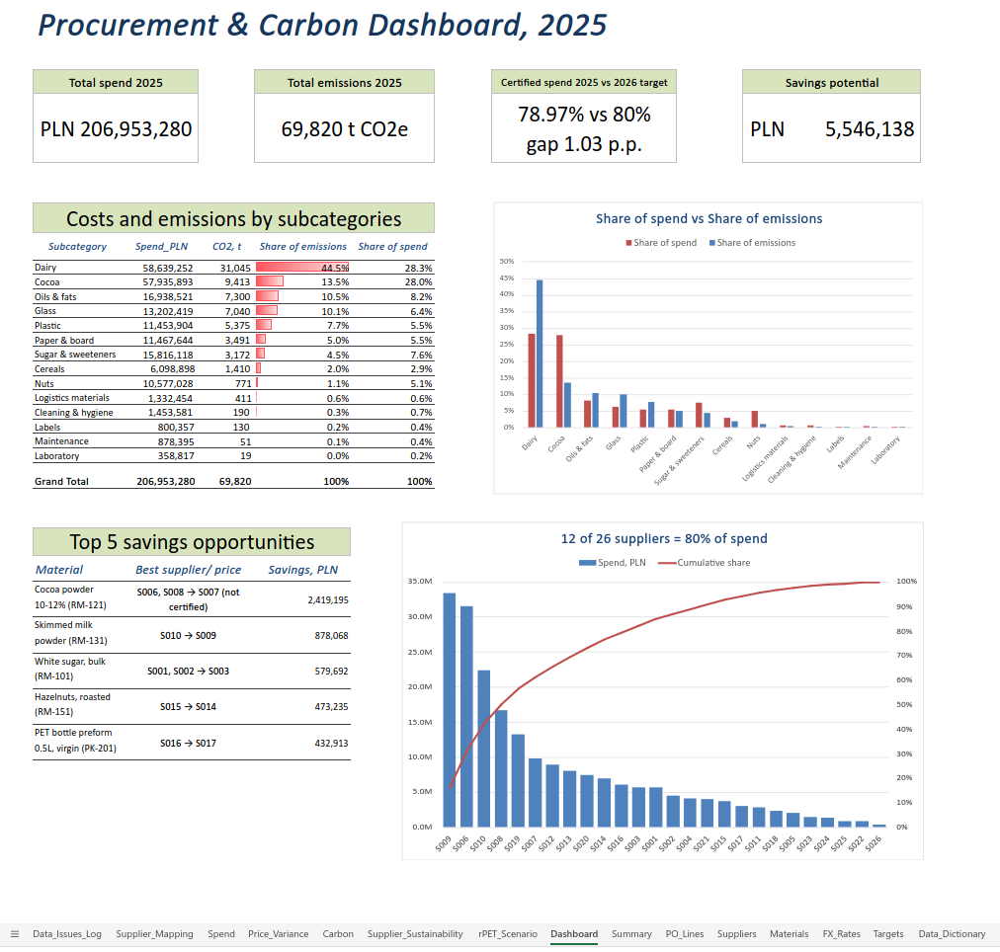

# Nordvita Procurement & Carbon — Spend and Supplier Analysis

## Tech Stack
- **Tool:** Microsoft Excel (Microsoft 365)
- **Functions:** XLOOKUP, IFERROR, TRIM, DATE + LEFT/MID/RIGHT, TEXT, IF/AND/OR, SUMIF, MINIFS
- **Analysis:** Pivot tables, Pareto analysis, price comparison, CO2 calculation, what-if scenario
- **Visualization:** Combo chart (Pareto), column chart, data bars, KPI cards

## Project Overview

In this project, I worked as a Data Analyst for Nordvita, a food company. I analyzed 5,807 purchase order lines from 2025 (26 suppliers, 22 materials).

Two managers needed answers:
- the **Procurement Manager** wants to spend less money;
- the **Sustainability Manager** wants to know how much CO2 comes from the things we buy, and how many suppliers have environmental certificates.

## Key Questions
- How much did we spend in 2025, on what and with which suppliers?
- Where do we pay different prices for the same material? How much can we save?
- Which materials create the most CO2?
- Do we reach the 2026 target: 80% of spend with certified suppliers?
- How much will it cost to use more recycled plastic (rPET), and how much CO2 will it save?

---

## Key findings

1. **A few suppliers get most of the money.** We spent 207.0M PLN. 12 of 26 suppliers get 80% of it. 47% of spend goes to Polish suppliers, 26% to Dutch suppliers.

2. **We can save up to 5.5M PLN (2.7% of spend).** We buy 9 materials from different suppliers at different prices. If we buy at the lowest price, we save money. Five materials give 86% of this saving:

| Material | Change supplier | Saving, PLN |
|---|---|---|
| Cocoa powder (RM-121) | S006, S008 → S007 (not certified) | 2,419,195 |
| Skimmed milk powder (RM-131) | S010 → S009 | 878,068 |
| White sugar (RM-101) | S001, S002 → S003 | 579,692 |
| Hazelnuts (RM-151) | S015 → S014 | 473,235 |
| PET bottle preform (PK-201) | S016 → S017 | 432,913 |

3. **Dairy creates the most CO2.** All purchased materials created 69,820 t CO2e. Dairy is 28% of spend but 44% of emissions. Cocoa costs almost the same as dairy, but creates 3.3 times less CO2. Skimmed milk powder alone creates 34% of all emissions (23,893 t).

4. **Certified spend is 79.0% — 1.03 p.p. (about 2.1M PLN) below the 2026 target.** Four suppliers without certificates (S016, S002, S021, S005) have a certified alternative that is also cheaper. Changing them saves money and helps reach the target. Cocoa is more difficult: the cheapest supplier has no certificate, and the cheapest certified supplier is about 10% more expensive.

5. **Recycled plastic costs about 125 PLN for each tonne of CO2 saved.** If we change 50% of normal PET preforms to recycled ones, we pay 169,477 PLN more per year and save 1,351 t CO2e. The price for one tonne is the same for any share, because cost and CO2 both grow in the same way.

**What to do first:** move volume from the four non-certified suppliers to cheaper certified ones; negotiate cocoa prices with certified suppliers; work with skimmed milk powder suppliers to reduce emissions; use more recycled plastic in bottles.

---

## Data

| Sheet | Content |
|---|---|
| `PO_Lines` | 5,807 purchase order lines: date, supplier, material, quantity, unit, price, currency, plant |
| `Suppliers` | 26 suppliers: country, currency, ISO 14001, EcoVadis score |
| `Materials` | 22 materials: category, subcategory, unit, emission factor |
| `FX_Rates` | Monthly EUR/PLN and USD/PLN rates |
| `Targets` | Targets for 2026 |

**Data problems I found and fixed**

| Problem | Rows | Fix |
|---|---|---|
| Duplicates (same po_number + po_line) | 38 | Sorted the data, marked duplicates and removed them from all totals |
| Dates saved as text | 173 | Changed to real dates with DATE(RIGHT, MID, LEFT) |
| Unit "t" | 276 | Changed to kg (×1000) |
| Unit "1000 pcs" | 202 | Changed to pcs (×1000) |
| Supplier names with extra spaces | 278 | Removed spaces with TRIM |
| Supplier names different from the list (capital letters or short names) | 732 | Matched to supplier ID with a mapping table |

**Other changes:** I changed EUR (1,592 rows) and USD (419 rows) to PLN with monthly rates. CO2 = quantity × emission factor. A supplier is "certified" if it has ISO 14001 or an EcoVadis score of 45 or more.

---

## Steps & Logic

### 1. Data cleaning
I fixed the problems in new columns and did not change the original data. Every fix is in the `Data_Issues_Log` sheet.

### 2. Spend
Pivot tables by category, subcategory, supplier, country and month. Pareto table: suppliers from biggest to smallest, with cumulative share.

### 3. Price differences
Average price for each material and supplier. Lowest price with MINIFS. Saving = (price − lowest price) × quantity.

### 4. CO2
CO2 by subcategory and material. I compared share of CO2 with share of spend.

### 5. Certified suppliers
Certified share of spend vs target. A list of suppliers without certificates and what to do with each one.

### 6. Recycled plastic scenario
A what-if model with one input cell (share of recycled plastic). It shows extra cost, CO2 saved and cost per tonne.

### Assumptions
- Prices stay the same as the 2025 average.
- Suppliers can deliver more without problems with quality.
- Before changing suppliers, we need to check transport costs, taxes and contracts.

---

## Dashboard



---

## Files

```
- Nordvita_Procurement_2025.xlsx (https://1drv.ms/x/c/7b4519628ea105a4/IQBZX3RLMnGoSIZ4wGf6HPcbAQWrxhWdytLynz63gwiZK1Q?e=XzYjUt)
- [Nordvita_Procurement_2025.xlsx](Nordvita_Procurement_2025.xlsx)
- README.md
- screenshots/
    ├── dashboard.png
```

*The data is not real. It was created for practice. Emission factors are examples, not official values.*